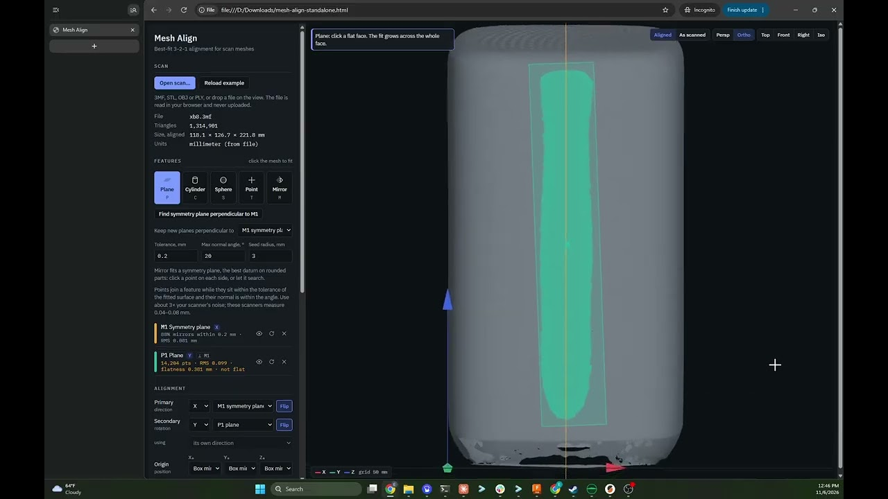

# Mesh Align

A browser tool for aligning 3D scan meshes before they go into CAD. You open a scan, fit datum features to it, choose which features set the axes and the origin, trim scan debris, and save a 3MF in millimeters with the transform embedded.

[Demo video](https://youtu.be/KHQ9Wo1QYOo): an XB8 scan aligned from a symmetry plane and a perpendicular face.

## Use it

1. Download [`dist/mesh-align-standalone.html`](dist/mesh-align-standalone.html). On GitHub, open the file and click "Download raw file".
2. Open it in your browser. Tested in Chrome.

That one file is the whole tool. There is nothing to clone, install or build, and it works offline: three.js is bundled in, and only the optional Google Fonts are fetched. Scans are read in the browser and never uploaded.

- Input: 3MF (units taken from the file), STL, OBJ or PLY (units chosen in the page).
- Best-fit features: plane, cylinder, sphere and point, each grown from one click across the face. A plane that keeps growing at double tolerance is flagged "not flat".
- Multi-face planes: one plane can span separate faces that lie in it, such as the tops of two bosses. Faces spread far apart set its tilt much better than one small face. Use the + button on a plane, or Shift-click with the Plane tool; a face that is not in the plane is refused.
- Symmetry planes (Mirror): click a point on each side of the part, or search automatically. The scan is mirrored onto itself and the plane is refined by robust point-to-plane matching. This is the best datum on rounded parts.
- Constraints: new planes, mirror planes and the automatic search can be kept perpendicular to an existing plane.
- 3-2-1 alignment: the primary feature sets one axis, the secondary feature (or a line between two features) sets the rotation, and each origin coordinate comes from a feature or the bounding box.
- Trim: a draggable cutting plane across X, Y or Z in the displayed frame. The part to be removed shows red, and trims can be undone.
- Output: a 3MF in millimeters. The transform (`aligned = M · [x, y, z, 1]` in the original scan's coordinates) is stored as the namespaced metadata entry `meshalign:transform`. "Apply a saved transform" reads it back from such a file, and re-aligning an aligned file chains the transforms.

In Fusion, use Insert → Insert Mesh with Center and Move to ground turned off, or the mesh moves again.

## Layout

- `src/core.js` holds the geometry, with no DOM: fits, symmetry, alignment solver, trimming, 3MF read and write, and the generated example part.
- `src/app.js` is the three.js viewer and UI.
- `src/page.html` is the page template and CSS.
- `build.py` bundles everything with esbuild into `dist/mesh-align.html` (page body only) and `dist/mesh-align-standalone.html`.

Build:

    npm install        # three 0.160.0 and esbuild 0.24.0
    python3 build.py

## Tests

- `node tests/test_core.mjs` runs the geometry tests on a noisy generated part with a known pose.
- `tests/e2e.py` is a real-browser run in the Playwright image:

      docker run --rm -v "$PWD":/w -w /w mcr.microsoft.com/playwright/python:v1.48.0-jammy \
        bash -c "pip install -q playwright==1.48.0; python3 tests/e2e.py"

- The rest need scans of your own, which are not in the repo. `tests/scan_*.mjs` are diagnostics that read `.3mf` files from `$MESH_ALIGN_SCANS` (default `scans/`). `tests/trim_e2e.py`, `tests/scan_shots.py`, `tests/curved_click.py` and `tests/xb8_sym_shot.py` run in the same image with the scans mounted at `/scans` (add `-v <scans dir>:/scans:ro`).

## Built with Claude

Mesh Align was built with [Claude Code](https://claude.com/claude-code), Anthropic's AI coding assistant. The design, the requirements and the testing on real scans came from the maintainer; most of the code was written by Claude.

## License

MIT; see `LICENSE`.
